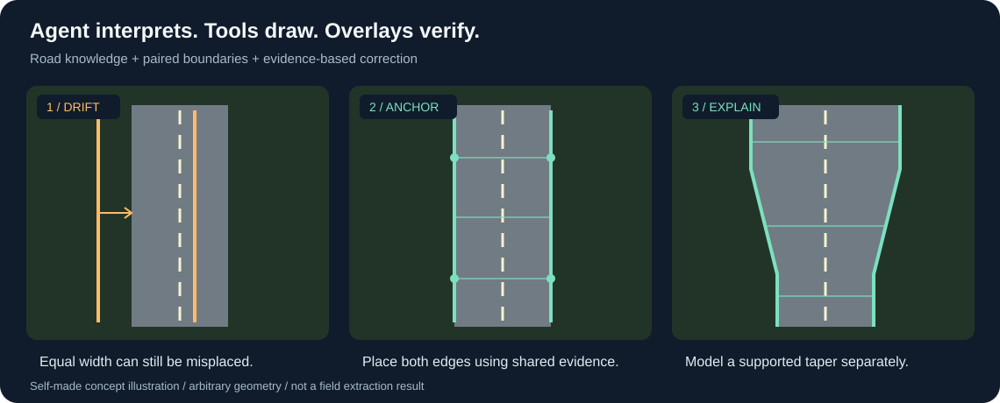

# Agentic Map Tracing

**让 Agent 理解边界为什么在这里。**

Agent-native skills for reasoning-driven satellite/aerial imagery interpretation and editable CAD/GIS tracing. **v0.1.0-beta.1** · [Agent entry](AGENTS.md) · [Install / 检索安装](docs/SKILL-DISCOVERY.md) · [Contribute / 共同改进](CONTRIBUTING.md)

把有经验描图人员的观察、场景理解、专业判断与反复纠错方法，整理成 Agent 可执行的影像判图与地物描绘 Skill。

**Observe → Understand → Reason → Trace → Verify → Correct**

观察影像 → 理解场景 → 综合推理 → 绘制几何 → 叠加核查 → 修正判断

[English](README.en.md) · [Agent 怎样判图](docs/interpretation-method.md) · [实际纠错经验](docs/correction-cases.md) · [道路 Skill](skills/satellite-road-edge-tracing/SKILL.md) · [验证范围](docs/validation.md)

## 从“哪里有边缘”到“这是什么边界”

**Agentic Map Tracing 是面向视觉 Agent 的影像判图与地物描绘 Skill 项目。** Agent 是观察、解释和决策的主体；现有 CAD/GIS 工具把它的判断落成可编辑几何，小型脚本辅助坐标、几何和证据整理。

一条路被树冠挡住时，有经验的描图人员会沿前后寻找清晰断面，结合车道标线、铺装外缘、路口形态和出入口推测遮挡部分。遇到冲突，会回去检查原判断。本项目尝试把这样的观察与推理过程交给 Agent，并让每次判断可以核查、修改。

核心资产是 **Agent 如何理解地物、选择证据、提出几何约束，以及发现错误后重新判断** 的方法。这里的“学习”指通过人工反馈改进 Skill 与辅助工具，不表示自动训练或更新模型权重。

**道路是第一个进入实战的专业模块。** 项目名称为后续地物留出空间；建筑、绿地、水系等目前属于规划，没有现成模块或通用精度承诺。

## Agent 在做怎样的判断？

以下是道路模块中已整理的判读方法，执行质量仍需逐处核验。

| 影像里的问题 | Agent 怎样观察与推理 | 证据的边界 |
| --- | --- | --- |
| 路缘被树冠遮住 | 缩小看整条路，沿前后找清晰断面，用共同走向和宽度解释遮挡段 | 树影不是路缘；支持不足时标为推测 |
| 车道标线清晰 | 区分中线、车道分界、边线和中分带，量法向间距，判断车道与外侧边带组成 | 白漆宽度不是车道宽；边缘标线也可能位于铺装内部 |
| 临近路口变宽 | 看标线、箭头、导流组织和实体岛，分开正常段、渐变段、稳定展宽段和口门 | 渠化须有证据，不能用于解释任意弯曲 |
| 路面与步道颜色接近 | 综合材质过渡、路缘、非机动车道、树池及空间连续性 | 相同灰度不证明相同材料；步道单列判断 |
| 有停放车辆或自行车 | 看位置、排列、朝向、活动空间和远端边缘，辅助解释道路功能 | 车辆可能违规停放或占用土肩，不能单独定位边界 |
| 有围墙、建筑和大门 | 用出入口与铺装连续性检验通路、场地和道路的关系 | 围墙不必平行于道路，屋檐和院内铺装不是路缘 |
| 人工画了参考线 | 读取边界、走向、等宽关系或未确定部分，与候选交叉核对 | 不只保护图层，也不把示意端点当测量坐标 |
| 线很顺，却整组偏移 | 同时看两侧，分别查显示配准、像素到对象、共同中心与道路组成 | 几何读回成功、端点接上均不能证明位置正确 |

这是一套人类判图经验驱动的视觉推理方法，不是一种已验证的新模型架构。执行要点见 [判图方法](docs/interpretation-method.md)。

## 三条决定性的原则

**先理解整个地物，再推断局部边界。** 局部看不清时，回到长段、相邻地物和清晰断面寻找证据。低分辨率影像无限放大不会产生新细节；对比度和边缘提示只辅助观察。

**专业知识用于约束与反证。** 清晰标线约束走向，车道组成帮助核宽，规则段两侧共同定位，真实渠化另段处理。常用尺寸用于检查合理性，不把现状道路强行画成规范宽度。

**Agent 应能否定自己的旧判断。** 新证据与候选冲突时，冻结旧版，核清证据，撤回错误假设。复查须有独立证据，不能用同一批猜点证明自己画对了。



## 价值也体现在纠错过程

真实试验中，曾根据树影里露出的窄灰带提出约 **5.5 m** 的支路候选。回看实际 CAD 窗口、读取人工长平行线后，发现与约 **10 m** 的断面示教冲突，于是撤销窄候选，按核清的示教关系重新顺接。两者均是该处影像/示教候选，不是实测值或通用路宽。

另一处道路两侧曾分别追逐亮暗，形成不合理的“花瓶形”。修正时重新读取长段标线，用共同道路带区分渐变与稳定段，避免仅把旧线平滑一下。

案例展示的是 **提出假设 → 发现矛盾 → 补充证据 → 改变判断**，也暴露了模型会犯错、已有复查可能失效的事实。去除工程标识的过程文字见 [纠错案例](docs/correction-cases.md)。公开包不包含原工程图或实际截图，概念图不作为效果证明。

## 与影像分割、道路提取工具的关系

| 项目 | 主要侧重 | 可怎样互补 |
| --- | --- | --- |
| [SamGeo](https://github.com/opengeos/segment-geospatial) | SAM 等模型的地理影像分割、交互提示和矢量输出 | 提供候选区域或边界供 Agent 解释 |
| [SAM-Road](https://github.com/htcr/sam_road) | 从航拍影像提取大范围矢量道路网络 | 提供路网信息，配合局部路面边界判读 |
| [SAM-Maps](https://github.com/tudelft-iv/sam-maps) | 组合道路图、可行驶区域分割和连接关系生成道路地图 | 配合局部语义解释、人工反馈和宿主核查 |
| **Agentic Map Tracing** | **把 Agent 的场景理解、专业推理和反复纠偏整理为可执行 Skill** | **调用现有工具，将判断落成可编辑几何并核查** |

这是主要侧重的比较，不是精度排名。已有方法同样可能利用上下文、专业先验、人工干预或 Agent 接口。本项目探索把复杂判读组织为通用视觉 Agent 的观察、推理和纠错流程，不以开发专用分割网络为主要交付。

分割、滤镜、边缘检测与矢量化均可辅助。Agent 需要解释为何接受某条边、证据如何冲突，以及哪里仍不确定。仓库不附专用分割权重，分割结果也不是必需输入。

## 当前模块与后续方向

| 模块 | 状态 |
| --- | --- |
| **Road Edge Tracing — 道路路面边线描绘** | 已有 Skill 和真实 CAD 迭代经验；局部结果获用户认可，尚无独立通用基准 |
| 人行道与路缘 | 道路模块已有辅助判读方法；独立模块规划中 |
| 建筑轮廓、围墙与场地边界 | 后续方向，尚未实现模块 |
| 绿地、停车场、水系等 | 后续方向，尚未实现模块 |

总项目仓库为 `agentic-map-tracing`；首个 Skill 保留 `satellite-road-edge-tracing`，继续通过 `$satellite-road-edge-tracing` 调用。道路专业知识留在道路模块，未来新增地物时再抽取真正可共享的部分。当前没有为规划模块建立空目录。

## 适用环境与模型建议

**目前现场使用的是18级卫星图，Agent宿主为Codex，绘图环境为AutoCAD及现有CAD智能底座。** 根据作者的现场使用反馈，**GPT-6.1 Sol + Low推理投入可用于完成常规描绘任务，建议以此作为起点，不建议采用更低能力或更低推理投入的配置。** 复杂位置建议提高到 **XHigh**，或交给视觉与推理能力更强的Agent复判。

| 条件 | 当前经验与建议 |
| --- | --- |
| 影像 | 实战使用18级卫星图；优先选择真实有效分辨率更高、标线和材质边界更清晰的影像，通常更有利于判读 |
| 常规路段 | Codex中的GPT-6.1 Sol，Low推理投入，配合本Skill及真实叠加复查 |
| 复杂位置 | 树冠遮挡、渠化、多车道、曲线、断面组成不明或反复偏移时，建议提高到XHigh，并集中处理该位置 |
| 更强Agent | 更强的视觉理解、空间推理和专业知识，结合明确提示与证据，通常更有利于处理复杂情况 |

**效果高度依赖Agent的推理能力和道路知识。** Skill提供观察与纠错方法，不能代替Agent完成语义判断。提示词应明确描绘口径、优先看长段标线与道路组成、两侧共同定位、人工示教语义，以及修后真实叠加复核。

18级是所用影像的地图瓦片缩放级别，不是统一的测量精度。更高等级若包含更清晰的真实影像细节通常有帮助；只把原图放大或插值不会增加信息。更强模型或XHigh也需复核实际输出。

以上是本项目的现场使用建议，不是经过受控测试得出的普遍能力下限或精度保证。模型和推理投入是不同维度；Low/XHigh是推理设置。设置名称可参考[OpenAI官方模型文档](https://developers.openai.com/api/docs/models/gpt-6.1-sol)。

## Recommended execution backend / 推荐执行底座

For Windows/AutoCAD 2026, use [CAD Agent Foundation](https://github.com/capskov/cad-agent-foundation), with the scoped [v1.2.0-beta.3 preview](https://github.com/capskov/cad-agent-foundation/releases/tag/v1.2.0-beta.3). It supplies native reads, proxy geometry, digests, bounded drawing, views/captures, raster-path repair and save feedback. This Skill supplies scene interpretation, road decisions and visual correction.

在Windows/AutoCAD 2026环境推荐智能底座新版；其他等价CAD/GIS后端可适配。底座与Skill分别安装，均可按任务独立选择。Skill不是MCP服务器，不增加后端缺失的操作。路径修复不等于影像配准，代理几何不等于专业属性；截图色彩与显示稳定性限制须结合原图和实际窗口复核。

## 使用道路模块

需要能读取 Skill、查看原始影像并调用 CAD/GIS 工具的视觉 Agent。现有实战来自 Codex 与 AutoCAD；其他宿主和连接器需另行验证。本技能不自带 CAD/GIS 连接器，输出格式取决于宿主能力。

将 `skills/satellite-road-edge-tracing` 文件夹复制到 Agent 的技能目录。Codex 常用位置为 `~/.codex/skills/`；其他宿主按其加载方式配置。

> 使用 $satellite-road-edge-tracing，沿这条路由逐处描绘相交道路的车行路面边线。先编号，结合长段标线、道路组成及人工参考判断两侧，区分步道和遮挡推测；在工程副本落图，查看真实叠加，保留修改理由与未确定事项。

提供原始影像、目标范围/路由、已有人工示教和可用绘图工具，明确车行路面、步道或铺装总边界的描绘口径。卫星及正射影像是当前方法的输入场景；其他来源、格式及配准质量需按实际工具核实。项目不从普通二维影像声称生成高程、等高线或测量地形图。

预期交付是可编辑边界、稳定编号、判断依据、同范围原图/候选及真实叠加对照、局部不确定性和修改记录。

## 仓库结构与辅助工具

```text
agentic-map-tracing/
├── README.md / README.en.md
├── docs/                          判图方法、纠错经验、验证范围与概念图
└── skills/
    └── satellite-road-edge-tracing/
        ├── SKILL.md
        ├── agents/openai.yaml
        ├── references/            道路专业方法、坐标、复查与工具适配
        ├── assets/audit-template.csv
        └── scripts/
            ├── geometry.py        坐标互转与等宽折线运算
            └── evidence_strips.py 原始坐标证据条带
```

几何脚本只用 Python 标准库；条带工具另需 Pillow 10.1+。脚本均为可选辅助，不识别道路。

```shell
python -m pip install "Pillow>=10.1"
python skills/satellite-road-edge-tracing/scripts/geometry.py --self-test
python skills/satellite-road-edge-tracing/scripts/evidence_strips.py --help
```

## 验证与贡献

这是实际工程迭代形成的早期技能体系。没有独立测量真值、跨地区基准或受控模型对照；不能保证不同模型/推理设置等效。许多判断和复查仍需 Agent 主动执行，尚未全部由程序强制拦截。

几何自检、条带运行和文件格式检查不证明视觉判读精度。当前公开包只含通用方法、工具、自制概念图和去除工程标识的经验文字；真实工程资料保留本地。详见 [验证范围](docs/validation.md)。

欢迎贡献有权公开的“原图 → 错误候选 → 证据与修正 → 实际叠加”案例，以及不同 Agent 的盲测、宿主适配和新地物专业 Skill。优先展示为什么改，而不只展示最后一张图。

Fork, modify, redistribute, and contribute improvements through issues and pull requests under MIT. 欢迎共享、改进和贡献，遵循MIT许可；见[贡献说明](CONTRIBUTING.md)。

## 许可

[MIT](LICENSE)。外部影像、规范和其他工具遵循各自许可。
